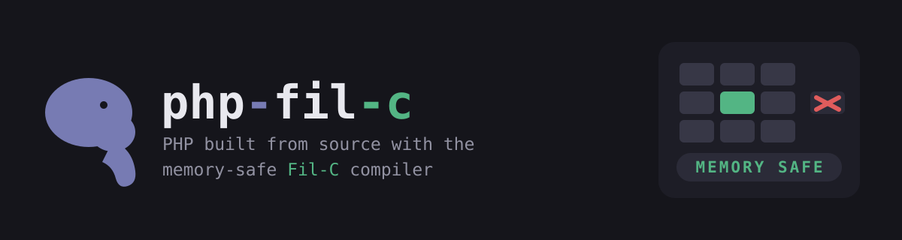

<p align="center">
  
</p>

<p align="center">
  <em>memory-safe PHP, from source -- a safe haven while PHP has a hard time.</em>
</p>

<p align="center">
PHP built with <a href="https://fil-c.org">Fil-C</a>: capability-based memory
safety turns every out-of-bounds, use-after-free and type confusion into a
panic instead of an exploit. Drop-in <code>php</code> / <code>wordpress</code>
Docker images, rebuilt the day a PHP CVE lands.
</p>

<p align="center">
<a href="https://github.com/hjanuschka/php-fil-c/actions/workflows/build-and-publish.yml"></a>


</p>

---

## Support matrix

Every published build is compiled from the **patched** PHP release that fixes
the two request-handling RCEs -- **CVE-2026-109618** (OOM corruption,
[GHSA-w8hw-w9fx-j79w](https://github.com/php/php-src/security/advisories/GHSA-w8hw-w9fx-j79w))
and **CVE-2026-109619** (stale global state,
[GHSA-6wmf-4rv5-p3rp](https://github.com/php/php-src/security/advisories/GHSA-6wmf-4rv5-p3rp))
-- and additionally ships the advisory's `session.upload_progress.enabled=0`
mitigation in every image.

| PHP | Release | CVE fixes | Fil-C patch | CLI | FPM | Apache (mod_php) | WordPress |
|-----|---------|:---------:|-------------|:---:|:---:|:----------------:|:---------:|
| **8.5.12** | 2026-10 | ✅ 109618 · 109619 | [`php-8.5.12-filc.patch`](patches/php-8.5.12-filc.patch) | ✅ | ✅ | ✅ | ✅ |
| **8.4.27** | 2026-10 | ✅ 109618 · 109619 | [`php-8.4.27-filc.patch`](patches/php-8.4.27-filc.patch) | ✅ | ✅ | ✅ | ✅ |
| **8.3.36** | 2026-10 | ✅ 109618 · 109619 | [`php-8.3.36-filc.patch`](patches/php-8.3.36-filc.patch) | ✅ | ✅ | ✅ | ✅ |
| **8.2.35** | 2026-10 | ✅ 109618 · 109619 | [`php-8.2.35-filc.patch`](patches/php-8.2.35-filc.patch) | ✅ | ✅ | ✅ | ✅ |
| **8.1.32** | 2026-10 | ✅ 109618 · 109619 | [`php-8.1.32-filc.patch`](patches/php-8.1.32-filc.patch) | ✅ | ✅ | ✅ | ✅ |
| 8.0.30 | EOL | backport needed | [`php-8.0.30-filc.patch`](patches/php-8.0.30-filc.patch) | ⏳ | ⏳ | ⏳ | ⏳ |
| 7.4 | EOL | backport needed | Filnix port | ⏳ | ⏳ | ⏳ | ⏳ |
| ≤ 7.3 / 5.x | EOL | none upstream | none | ❌ | ❌ | ❌ | ❌ |

Legend: ✅ built + smoke-tested · ⏳ planned / in progress · ❌ no Fil-C port exists.
`versions.json` is the machine-readable source of truth for this table.

**Why these five versions?** They are exactly the releases PHP shipped the two
RCE fixes in. Older lines (8.0, 7.4) are EOL and did not get the fixes, so
supporting them means backporting the CVE patches *and* the Fil-C port, plus
building libxml/OpenSSL versions that old PHP can compile against inside the
image (optfil ships only current libs) -- see [PLAN.md](PLAN.md).

## Images

`ghcr.io/hjanuschka/php-fil-c`, `linux/amd64`. Tags are
`<php>-<sapi>-bookworm` (plus `<minor>-<sapi>-bookworm` and a bare
`<sapi>-bookworm` for the default).

```sh
# CLI
docker run --rm ghcr.io/hjanuschka/php-fil-c:8.4-cli-bookworm -v
# FPM (port 9000)
docker run -d -p 127.0.0.1:9000:9000 ghcr.io/hjanuschka/php-fil-c:8.4-fpm-bookworm
# Apache + mod_php (port 8080) -- Apache itself is built with Fil-C
docker run -d -p 127.0.0.1:8080:8080 ghcr.io/hjanuschka/php-fil-c:8.4-apache-bookworm
# WordPress drop-in (needs a MySQL/MariaDB; env contract matches the official image)
docker run -d -p 127.0.0.1:8080:8080 \
  -e WORDPRESS_DB_HOST=db -e WORDPRESS_DB_USER=wp -e WORDPRESS_DB_PASSWORD=wp -e WORDPRESS_DB_NAME=wp \
  ghcr.io/hjanuschka/php-fil-c:8.4-wordpress-bookworm
```

The Apache image runs the **whole process on Fil-C**: APR, APR-util, httpd and
mod_php are all compiled with `filcc`, so there is no native/Fil-C libc mixing.
The WordPress image is a drop-in for the official `wordpress` image (same
`WORDPRESS_DB_*` env contract, wp-cli included, auto-installs on first boot).

### WordPress + MySQL (drop-in demo)

```yaml
# docker-compose.yml
services:
  db:
    image: mysql:8
    environment:
      MYSQL_DATABASE: wordpress
      MYSQL_USER: wp
      MYSQL_PASSWORD: wp
      MYSQL_ROOT_PASSWORD: root
  wordpress:
    image: ghcr.io/hjanuschka/php-fil-c:8.4-wordpress-bookworm
    ports: ["8080:8080"]
    environment:
      WORDPRESS_DB_HOST: db
      WORDPRESS_DB_USER: wp
      WORDPRESS_DB_PASSWORD: wp
      WORDPRESS_DB_NAME: wordpress
    depends_on: [db]
```

Only PHP runs under Fil-C; the database server is a normal MySQL/MariaDB
reached over TCP -- exactly how a real LAMP split works.

## Build from source

Everything builds inside Docker (no host toolchain needed):

```sh
docker build -f docker/Dockerfile --target cli     --build-arg PHP_VERSION=8.4.27 -t php-filc:cli .
docker build -f docker/Dockerfile --target fpm     --build-arg PHP_VERSION=8.4.27 -t php-filc:fpm .
docker build -f docker/Dockerfile --target apache  --build-arg PHP_VERSION=8.4.27 -t php-filc:apache .
docker build -f docker/Dockerfile --target wordpress --build-arg PHP_VERSION=8.4.27 -t php-filc:wordpress .
```

The `deps` stage compiles expat, APR, APR-util, httpd, SQLite and oniguruma
with Fil-C; the `php` stage compiles PHP (cli + fpm + apache2handler) against
them. To add a version: drop `patches/php-<ver>-filc.patch`, add a
`versions.json` entry, build.

`build.sh` is a standalone host build (needs `/opt/fil`) if you prefer not to
use Docker.

## What Fil-C changes here

Fil-C is a drop-in C compiler (clang-based) that gives every pointer a hidden
capability and checks every access. PHP needs a small port patch (all
`#ifdef __FILC__`, a no-op for normal builds) for the places that store
pointers as integers or use tricky asm:

- **Pointer-as-integer sites** -- weakref/WeakMap keys and typed-property
  source lists are retagged via pointer arithmetic or a weak `zexact_ptrtable`.
- **Inline asm** -- portable C paths for `zend_safe_address`, string compare
  and `fast_long_*`.
- **Fibers** -- built `--disable-fiber-asm` so fibers use `ucontext`.
- **Allocator** -- defaults to PHP's tracked system allocator so each value
  gets its own capability and use-after-free between values is caught.

Adapted from the upstream
[`php.projeny`](https://github.com/pizlonator/fil-c/blob/deluge/projects/php.projeny)
port by Filip Pizlo, and informed by
[Filnix](https://github.com/mbrock/filnix).

## Known limitations

- **No JIT.** `--without-pcre-jit --disable-opcache-jit` -- Fil-C cannot
  execute generated machine code. A JIT-through-C path exists upstream
  ([PLAN.md](PLAN.md) P1).
- **OPcache off by default.** The port panics when OPcache persists certain
  classes; images ship `opcache.enable=0`.
- **Performance.** Capability checks + GC make PHP ~1.5-4x slower than native.
  This is a safety research build, not a production drop-in for throughput.
- **Extensions not yet built** (no Fil-C lib in `/opt/fil`): gd, zip, sodium,
  xsl, ldap, gmp. mysqli/pdo_mysql (mysqlnd), pdo_sqlite/sqlite3, curl, dom,
  xml, mbstring, intl, openssl are built.
- **`linux/amd64` only** for now.

## Security

Fil-C turns memory-safety violations (the OOB read, the use-after-free) into a
**panic** rather than an exploitable primitive -- exactly the bug class behind
the recent PHP session/OOM RCEs. It does **not** fix the underlying logic, and
a stale pointer kept alive by the GC may not panic at all, so the images are
built from **patched** PHP with Fil-C layered on top as defence-in-depth.

Every image sets `session.upload_progress.enabled = 0`, the mitigation
recommended in GHSA-6wmf-4rv5-p3rp for CVE-2026-109619.

## Layout

```
versions.json            build matrix: version -> tarball sha256 + patch + status
patches/                 Fil-C port patch per PHP version
docker/Dockerfile        multi-stage build: deps -> php -> cli/fpm/apache/wordpress
docker/wordpress/        WordPress entrypoint (env -> wp-config, auto-install)
build.sh                 standalone host build + smoke test
.github/workflows/       build-and-publish (GHCR matrix)
PLAN.md                  roadmap: adopt Filnix patches, JIT, per-version branches
```

## License

PHP is PHP-3.0. Fil-C is LLVM/PAS licensed. This repo's scripts: MIT.
